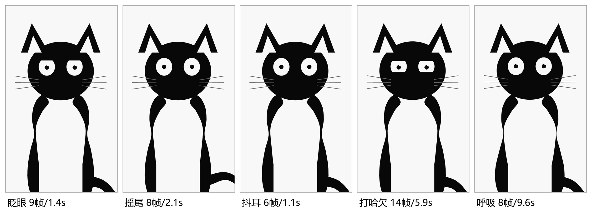

# 我把一台吃了十年灰的 Kindle,改成了墙上的信息站

家里抽屉底下有台 Kindle Paperwhite 3。2016 年买的,用了大概半年,之后就被手机替代了。屏幕完好、电池还能撑两三周、系统流畅,唯一的用途是每年大扫除时被翻出来,擦一擦,再放回去。

电子墨水屏有一种很奇怪的宿命:它的优点(省电、不刺眼、常亮不烧屏)在"看书"这个场景里被手机彻底碾压,但在"一直挂在墙上显示信息"这个场景里,没有任何屏幕打得过它。

所以我想试试:把这台闲置的 Kindle 变成挂在玄关的一块信息屏。

现在它每天显示这些东西:日历、天气、人生周历、一只会动的猫。触摸翻页,长按退出,全部离线运行,一周充一次电。


---

## 一、先说成果

### 1. 四个页面,触摸翻页

| 页面 | 内容 |
|---|---|
| 日历 | 月视图 + 今天高亮 + 节假日 |
| 天气 | 当前温度、今日高低温、7 天趋势(open-meteo 免费 API) |
| 人生周历 | 一张图看完整个人生:每格一周,已过的填黑 |
| 猫 | 一只会眨眼、呼吸、摇尾、抖耳、打哈欠的猫 |


人生周历这一页我自己最喜欢。它把 80 年画成 4160 个格子,每格一周,已经过去的涂黑。第一次打开时会有点不适--原来已经用掉这么多了。

### 2. 猫是真的会动

这是最后做、也是最费劲的一项。现在它有 5 个动作、45 帧:

| 动作 | 帧数 | 一张完整循环 | 每帧间隔 |
|---|---|---|---|
| 眨眼 | 9 | 1.4 秒 | 150ms |
| 摇尾 | 8 | 2.1 秒 | 260ms |
| 抖耳 | 6 | 1.1 秒 | 190ms |
| 打哈欠 | 14 | 5.9 秒 | 420ms |
| 呼吸 | 8 | 9.6 秒 | 1200ms |

每个动作演 110 秒，然后自动换下一个。所以盯着看两分钟能看到一轮完整的“眨眼 → 摇尾 → 抖耳 → 打哈欠 → 呼吸”。



（上面是五个动作在 Kindle 屏幕上的真实截图，不是渲染预览。）


这些帧不是 AI 生成的,是代码画的。原因下面会说。

### 3. 整机离线、一周一充

- 设备只连家里 WiFi,不依赖任何云端服务
- 天气数据来自 open-meteo 免费 API,无 key、无配额
- 屏幕常亮但电子墨水只在刷新时耗电
- 实测一周充一次

### 4. WiFi 坏了能自己修

这个很实用。Kindle 的 WiFi 有个坑:只要路由器重启或换信道,它就再也连不上,而且报错信息完全不指向真实原因。我写了三个 KUAL 菜单项:

- **WiFi 一键修复**:自动扫描 → 关联 → 拿 IP,全程 20 秒
- **WiFi 诊断**:把扫描结果、关联状态、密码验证阶段全打出来
- **WiFi 手册**:四页图文,直接显示在 Kindle 屏幕上


---

## 二、技术上踩的几个坑

这部分我只挑最有意思的说,完整实现和代码都在 GitHub 上。

### 坑一:电子墨水的"省电",是有代价的

我原以为电子墨水屏刷新很慢,所以动画做不出来是因为刷新率不够。实测之后发现完全相反:

| 刷新范围 | 波形 | 实测耗时 |
|---|---|---|
| 小补丁 293×129 | GC16 | 20~30ms |
| 小补丁 293×129 | A2 | 20~40ms |
| 全屏 1072×1416 | GC16 | 150ms |

小补丁只要 **20~40 毫秒**。而动画帧间隔是几百毫秒。**刷新速度从来不是瓶颈,还有 10 倍余量。**

真正的代价在别处:

- **A2 波形**:快、不闪屏,但只做黑白阈值化,中间灰全部压成同一色。实测某个补丁的灰阶丰富度从 5.1% 掉到 1.9%,呼吸那种柔和起伏直接就没了。
- **GC16 波形**:保留 16 级灰阶,但每一帧都会先闪一下黑白再成像。连续用它做眨眼,看着像"屏幕在闪",不像"猫在眨眼"。

所以波形必须按动作分:眨眼用 A2,呼吸和舔爪用 GC16。一刀切一定有一半场景是错的。

### 坑二:动画看起来像"只有眼睛在动"

第一版动画做完,用户反馈说"只看到眼睛在变,不像动态图"。

这个反馈很准。因为当时每个姿势只有一张基图 + 一对眼睛补丁,**结构上就只有眼睛能变**。想让它像动画,必须有整套序列帧。

于是我试了 AI 生图,三条路全失败了:

| 方案 | 结果 |
|---|---|
| 一张图里画 3×2 格 sprite sheet | 帧间差异 21~40%,宽高比在 1.24~1.64 之间乱跳 |
| 拿原图做局部编辑(只改舌头) | 改掉 29% 像素,尺寸从 1072×1416 变成 1024×1536 |
| 2×2 只改尾巴位置 | 看起来像四只不同的猫 |

结论:**AI 生图无法保证跨帧像素一致**。它每次都在重画,而不是在改。拼接成动画就是抖动。

最后我回到程序化绘制:用 PIL 把猫拆成参数化的部件(头、耳、眼、嘴、身体、尾巴),每个动作是一组参数,逐帧渲染。像素天然一致,因为每一帧都是同一份代码算出来的。

代价是画出来不够"艺术"。第一版像积木拼的--头画成了黑圈套白圈,像戴头盔。改了几轮才勉强能看。

### 坑三:我的测试数据一直在骗我

有段时间我很确信动画在动,因为 `cat.blink` 计数器一直在涨。

后来发现这个计数器在计算层无条件 +1,跟**有没有真的贴上屏幕**毫无关系。

真正可靠的验证只有一条:直接采 framebuffer。

```
dd if=/dev/fb0 bs=1088 skip=<y> count=<h> | md5sum
```

只采"该动作的那块矩形",看 md5 是否在多个值之间交替。这次验收就是这么做出来的:

| 动作 | 截图与对应帧差异 | 帧间最大差异 |
|---|---|---|
| 眨眼 | 0 像素 | 7,422 |
| 抖耳 | 0 像素 | 12,950 |
| 打哈欠 | 0 像素 | 56,563 |
| 呼吸 | 86 像素 | 14,468 |
| 摇尾 | 907 像素 | 15,520 |

同时还要采一个远离所有动作矩形的对照区,确认它**不动**。否则你分不清是"猫在动"还是"整屏在抖"。

### 坑四:`status_code=1` 是个陷阱

Kindle WiFi 连不上时,日志里会刷:

```
CTRL-EVENT-ASSOC-REJECT status_code=1
Added BSSID 00:00:00:00:00:00 into blacklist
```

看到 `status_code=1` 和 `blacklist`,第一反应一定是"路由器拒绝了我"或"密码错了"。

都不是。

真实原因是 `wpa_supplicant.conf` 里 `ap_scan=2`。这个模式不主动扫描,supplicant 没有 BSS 缓存,关联请求里的 BSSID 退化成全零 `00:00:00:00:00:00`,也没有 RSN IE。路由器按标准只能回一个 `status_code=1`。

判断依据很简单:**关联阶段就被拒 = 密码根本没参与验证**。密码错误的表现是关联成功后 `4-Way Handshake failed` 或 `reason=15`。两者排查方向完全相反。

改成 `ap_scan=1`,并且关联前先 `wpa_cli scan` 等目标 SSID 出现,一次就通了。

### 坑五:两个进程各自持有一份状态

有个很诡异的 bug:换了姿势之后,屏幕上出现"新姿势里嵌一只旧眼睛"。

根因是 `CAT_CUR` 是 shell 变量,每个进程一份。菜单或 `carousel.sh catnext` 在独立进程里换了动作,守护进程里的 `CAT_CUR` 还是旧值,于是拿旧补丁往新基图上贴。

修法是:动作状态以文件 `cat.pose` 为唯一事实来源,贴补丁前每次核对。

同类坑还有一堆:`page.idx` 被两个脚本分别写成数字和页名、`guard` 采样到状态栏自己的时钟导致自激、`preventScreenSaver` 被守护进程每轮无条件重设导致永不休眠......都是"两个东西各自以为自己是权威"。

---

## 三、完整实现

代码、脚本、渲染器、WiFi 修复流程、以及那 45 帧猫的生成器,都在这里:

**https://github.com/xishaochen/kindle-dashboard**

仓库里包含:

- `bridge.py` - PC 侧服务,出图、命令队列、心跳、代理
- `render_calendar.py` / `render_weather.py` / `render_lifeweeks.py` - 三个信息页渲染器
- `tools/catkit_v3.py` - 猫渲染器(5 动作 × 45 帧,参数化部件)
- `kindle/weatherdash-tools/carousel.sh` - 设备侧轮播守护 + 多帧播放器
- `kindle/weatherdash-tools/wifi_repair.sh` - WiFi 一键修复
- `kindle/weatherdash-tools/wifi_diag.sh` - WiFi 诊断
- 4 页 WiFi 图文手册

---

## 四、最后

改造前后,这台设备的硬件没有任何变化。

它还是那块 2016 年的屏幕,还是那颗慢吞吞的处理器,还是那块一周一充的电池。变的只是它每天在做的事--从"抽屉里的纪念品"变成"玄关上的信息站"。

有意思的是,做完之后我发现自己路过玄关会多看它两眼。不是为了看天气,天气手机上也有。是因为那只猫真的在动。
