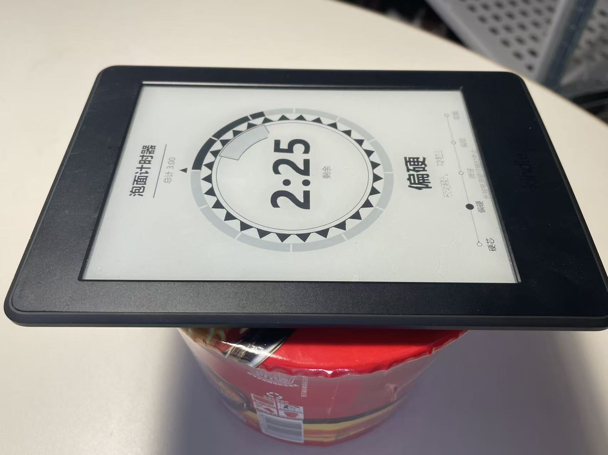

# 我把那台吃了十年灰的 Kindle 挂到了墙上

先说一张图。



红色桶装面，盖子上压着一台 Kindle。屏幕上是 2:25 的倒计时，右边竖着一排字，硬芯、偏硬、弹牙、偏软、软糯，一个黑点停在偏硬上。

这个功能我确实在用。

## 一、起因

抽屉最底下那台 Kindle Paperwhite 3，2016 年买的。用了不到一年，被手机替掉，之后就一直在那儿躺着。

屏幕没坏，电池到现在还能撑两三周，系统也不卡。这些年它唯一的作用，就是每年大扫除被翻出来，擦一擦，再塞回去。

电子墨水屏这东西的处境很怪。省电、不刺眼、常亮不烧屏，这些优点放在看书上被手机全盖过去了。可要论一直挂在那儿显示点东西，还真没有别的屏比它合适。

去年冬天有个周末实在没事干，我就把它翻出来了。

没列计划，想到哪做到哪。自己家里折腾，做废了也没人看见。

## 二、顺带说个背景

动手那阵子，我正好在读卡兹克的文章。

他写过一篇讲 REA 的，叫《手把手教你用 AI 逆向现实世界，把一切改成自己喜欢的样子》。REA 是 Reverse Engineer Anything 的缩写，GitHub 上 `morluto/rea` 那个仓库，一个把逆向工程交给 Agent 的 MCP 工具，能从应用行为一路挖到二进制。

说清楚一点，我这个项目没用上 REA。它是拿来逆向别人程序的，我这是给自家旧设备写脚本，两码事。

但那种劲头是有影响的。看见一个东西，先别问它该干什么，先想它还能干什么。

## 三、先说成果

### 1. 四个页面，手指划着翻

| 页面 | 内容 |
|---|---|
| 日历 | 月视图，今天高亮，节假日 |
| 天气 | 当前温度，今日高低温，七天趋势 |
| 人生周历 | 一条横轴排开整个人生，每格一周，已过的填黑 |
| 猫 | 一张自家猫的插画 |


人生周历这一页我一直留着。

80 年，4160 个格子，一格一周，过去了的填黑。头一回打开，黑的已经有一大片了。

看着不舒服，但没删。

### 2. 天气页，一个免费接口就够了

天气是第一个做的。

数据从 open-meteo 拿。不用注册，不用 key，也没有配额限制，一次请求能拿到当前温度、今日高低温和未来七天。

设备上的时间是联网校过的。`dash.sh` 里有个 `sync_clock`，启动时取一次网络时间写进系统时钟，再 `hwclock -w` 落到 RTC，所以日历里那个「今天」不会错。

天气就不一样，它是按天缓存的。轮播脚本里存了个 `stamp.weather`，记着 `date +%F`，当天渲染过就跳过，不再请求。所以「当前温度」其实是一天里某个时刻的温度，白天不会自己更新。


图好画。耗时间的是让它自己连上网。

Kindle 的 WiFi 有点轴。路由器重启一下，换个信道，或者干脆放几天没动，它就可能掉线。报错信息还跟真实原因不沾边。

我在这上面耗了好几个晚上。

最后写了个小脚本把每个阶段的日志全怼出来，才看清是怎么回事。

```
CTRL-EVENT-ASSOC-REJECT status_code=1
Added BSSID 00:00:00:00:00:00 into blacklist
```

看见这两行，第一反应都是路由器把我拒了，或者密码填错了。

我一开始就是这么想的，还白重置了好几次密码。

后来发现跟密码没关。是配置里一个 `ap_scan=2` 惹的祸。这个模式不做主动扫描，supplicant 手上没有 BSS 缓存，关联请求里的 BSSID 就退化成一串全零，加密参数也没带上。按协议标准，路由器只能回一个拒绝。

分清楚这个有个窍门。在关联阶段就被拒，说明密码压根没参与验证。密码错了是另一回事，表现是关联成功之后握手才失败。这两个方向正好相反，查反了只会越查越远。

改回 `ap_scan=1`，再让它关联之前先扫一遍、等目标 SSID 出来，一次就通了。

后来我把这套流程包成三个菜单项，一键修复、诊断，还有一份图文手册。出问题自己点一下，不用翻聊天记录。


### 3. 猫这一页，最后选了静态

猫是最后加的。

一开始是想做动画。眨眼、摇尾、抖耳，都试过。两版做下来，动作怎么调都像抽筋，盯久了心里发毛。

折腾两天，我放弃了。就一张静态插画挂在那儿，反而挺好。

先给家里那只猫拍了张照，丢给生图模型，让它照着画成平涂线稿。


左边是原照片，我家那只，叫皮蛋。右边是照着画的插画。上屏的是右边这张，压到 16 级灰阶，颜色全没了，只剩明暗。

静态的好处说起来有点无聊。不占 CPU，不费电，不用盯着刷新，看久了也不觉得哪儿别扭。

### 4. 整机离线，一周一充

- 设备只连家里 WiFi，不依赖任何云端服务
- 屏幕常亮，电子墨水只在刷新时耗电
- 实测一周充一次

## 四、泡面计时器

回到开头那张图。

做到这一步，我自己都觉得跑偏了。这哪还是什么信息站，分明是个电子玩具。

那就一路偏到底。

菜单里点一下开始，三分钟倒计时。右边那排软硬度是照着泡面包装上的说法抄的，随着时间推移黑点往下走，告诉你现在这面到哪一步了。

到点没法响铃，墨水屏没喇叭，就把整页换成一行提醒。

这下它算是名副其实了。真能盖在桶装泡面的杯口上，那三分钟也不用自己盯着表。

## 五、踩的两个坑

挑两个记得最清楚的写。完整代码在文末。

### 坑一 省电是有代价的

我一开始认定动画做不出来是因为刷得太慢。

后来测了一下，发现正好相反。

| 刷新范围 | 实测耗时 |
|---|---|
| 小补丁 293×129 | 20 到 40 毫秒 |
| 全屏 1072×1416 | 150 毫秒 |

小补丁才几十毫秒，而动画帧间隔是几百毫秒。刷屏从来不是瓶颈，手上一直有十倍余量。

卡人的是别的地方。

快刷模式只做黑白阈值，中间灰全压成一个色，柔和的过渡直接没了。全灰阶模式留得住层次，但每一帧都要先闪一下黑白再成像。

所以波形得看动作挑。一刀切过去，总有一半场景是难看的。

这也是我最后把猫做成静态图的原因。不是懒，是算了一下，为那么点动态效果要付的代价，不值。

### 坑二 两个地方都觉得自己说了算

有个 bug 折腾了我很久。

屏幕上冒出一只旧眼睛，嵌在新画面里，怎么擦都擦不掉。

查了半天才找到根因。当前状态存在 shell 变量里，而 shell 变量每个进程一份。菜单在另一个进程里换了动作，守护进程手里还是旧值，拿着旧补丁往新图上贴。

改法是让状态落到文件里。谁改都改文件，用之前先读一遍。

后来发现这毛病不止一处。`page.idx` 被两个脚本一个写数字一个写页名。看门狗采样到状态栏自己的时钟，自己触发自己，疯狂重画。常亮标记被守护进程每轮无条件重设，屏幕就再也不休眠。

全是一个毛病。两个地方都觉得自己说了算，就一定会打架。

## 六、代码

**https://github.com/xishaochen/kindle-dashboard**

- `pc/bridge.py`，PC 侧服务，出图、命令队列、心跳
- `pc/render_*.py`，日历、天气、周历渲染器
- `kindle/weatherdash-tools/carousel.sh`，设备侧轮播守护
- `kindle/weatherdash-tools/wifi_repair.sh`，WiFi 一键修复

## 七、最后

硬件我一样没动。还是 2016 年那块屏，那颗慢吞吞的处理器，那块一周充一次的电池。

变的只是它每天干的事。从抽屉里的纪念品，变成玄关上的那块屏。

做完之后我路过玄关会多看它两眼。天气手机上也有，我不是去看天气的。就是那块屏上有只猫，我家那只。

至于那个老梗嘛。

电子墨水屏当不了主角，当盖子确实一流。何况现在它还自带计时。

*（压面条这种大事，还得靠 2016 年的老将。）*
