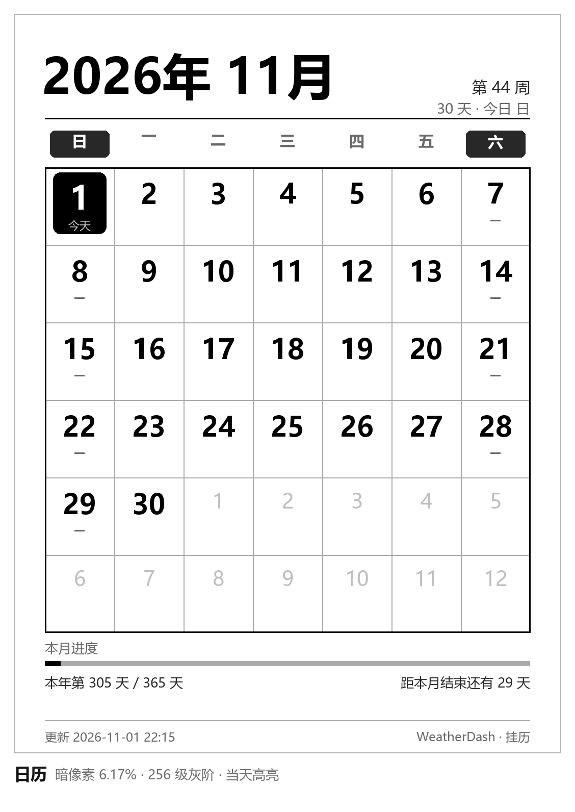
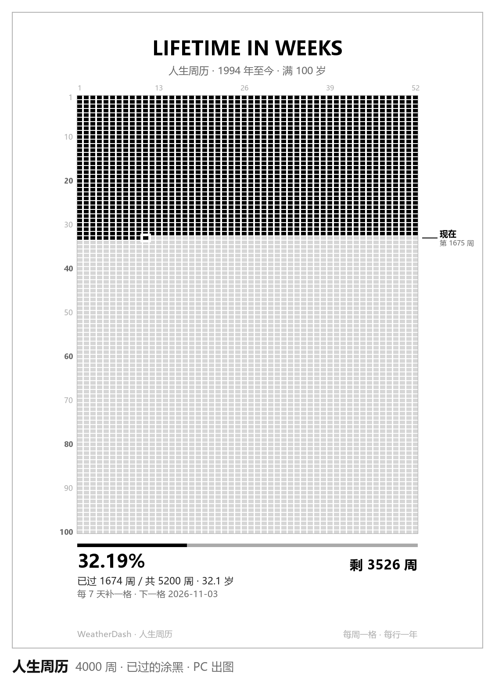
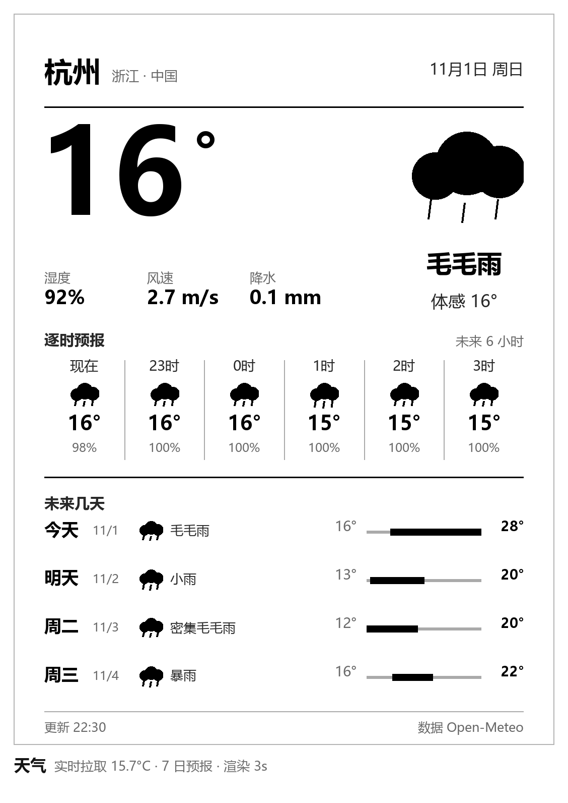
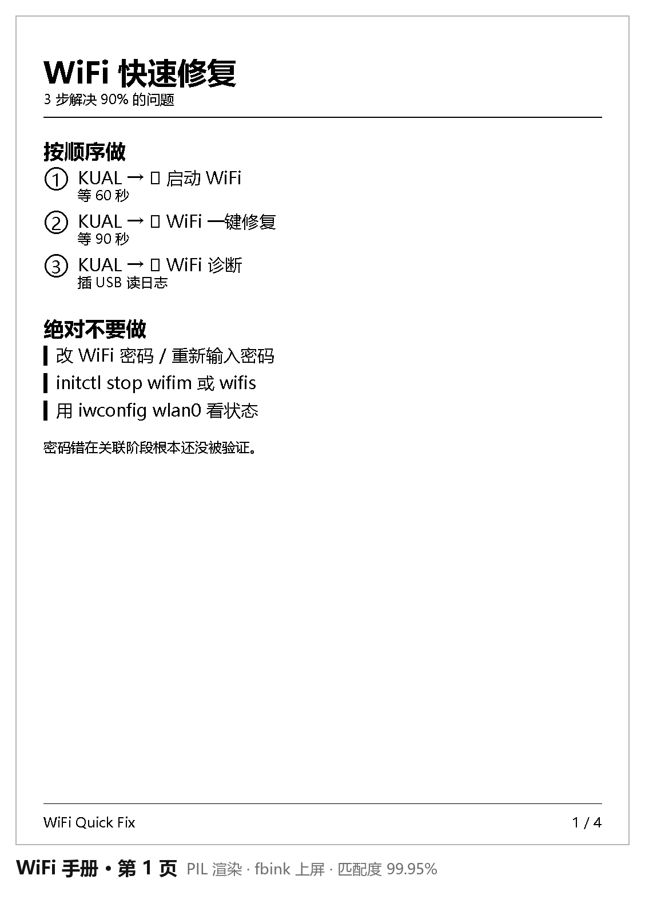
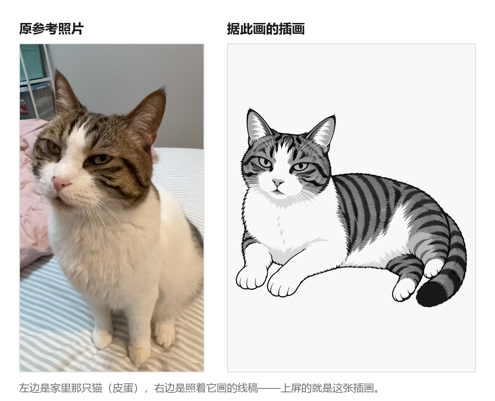
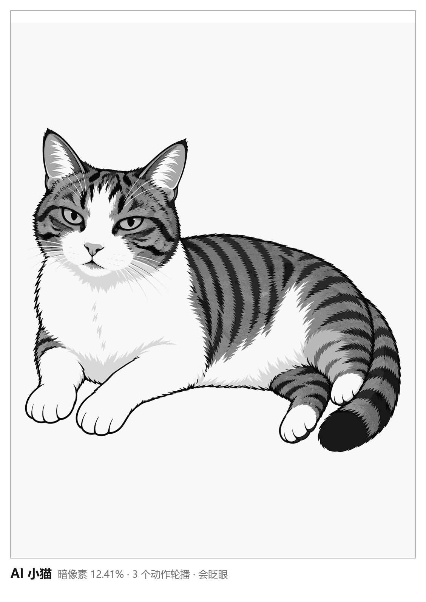
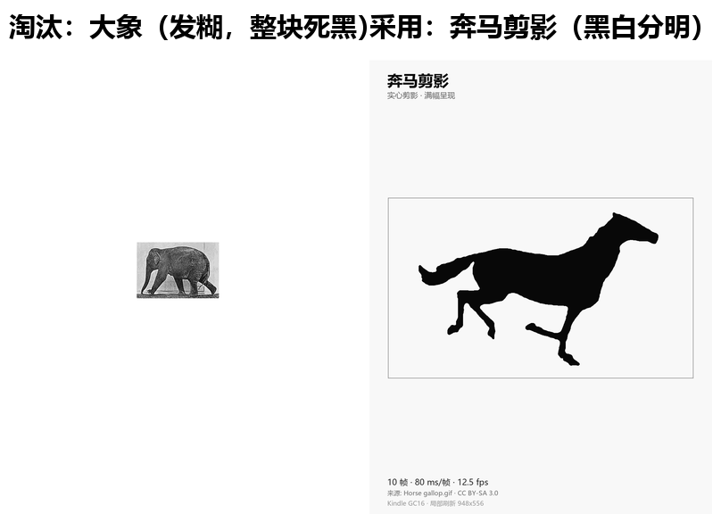
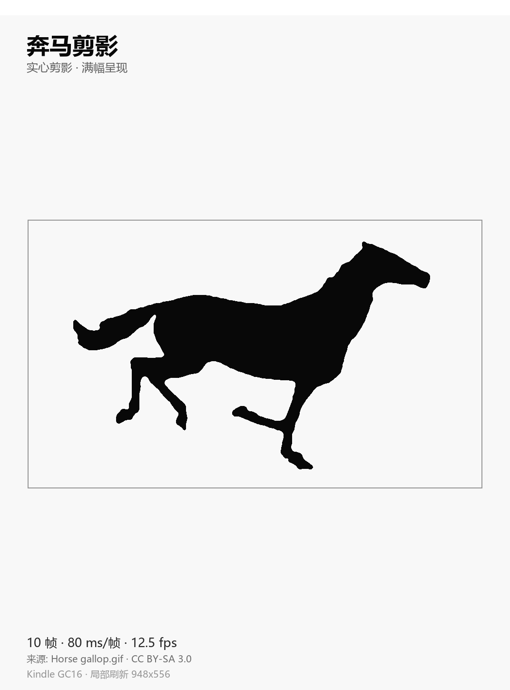
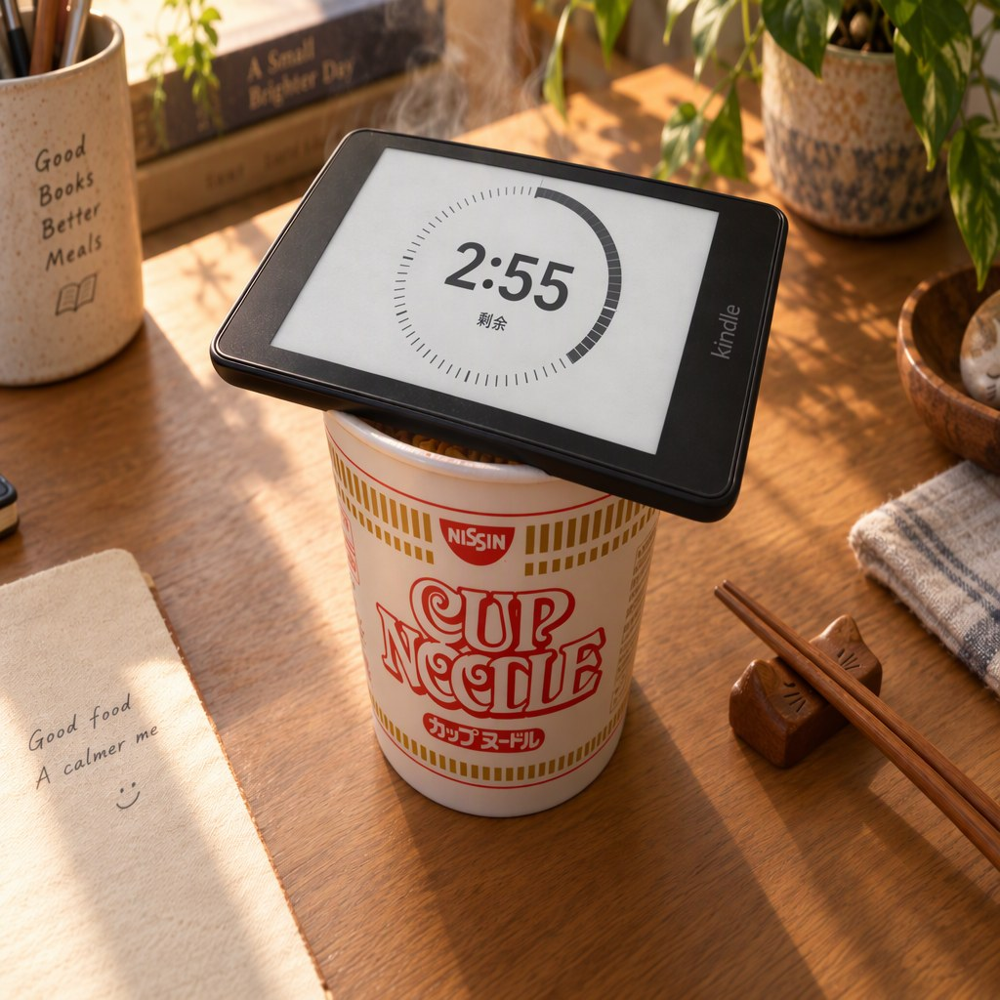

# 我把一台吃了十年灰的 Kindle,改成了墙上的信息站

家里抽屉底下有台 Kindle Paperwhite 3。2016 年买的,用了大概半年,之后就被手机替代了。屏幕完好、电池还能撑两三周、系统流畅,唯一的用途是每年大扫除时被翻出来,擦一擦,再放回去。

电子墨水屏有一种很奇怪的宿命:它的优点(省电、不刺眼、常亮不烧屏)在"看书"这个场景里被手机彻底碾压,但在"一直挂在墙上显示信息"这个场景里,没有任何屏幕打得过它。

于是某个周末我就动手了。没什么规划,想到一块做一块——反正是在自己家里折腾,做砸了也没人看见。

现在它每天显示这些东西:日历、天气、人生周历、一张自家猫的插画、一匹在跑的奔马,还有一个泡面计时器。触摸翻页,长按退出,全部离线运行,一周充一次电。



---

## 一、先说成果

### 1. 五个页面,触摸翻页

| 页面 | 内容 |
|---|---|
| 日历 | 月视图 + 今天高亮 + 节假日 |
| 天气 | 当前温度、今日高低温、7 天趋势 |
| 人生周历 | 一张图看完整个人生:每格一周,已过的填黑 |
| 猫 | 一张自家猫的插画 |
| 奔马 | 一匹会跑的剪影 |



人生周历这一页我自己最喜欢。它把 80 年画成 4160 个格子,每格一周,已经过去的涂黑。第一次打开时会有点不适——原来已经用掉这么多了。

### 2. 天气页:一个免费接口就够了

天气是我最常用的那一页,也是最先做的。

数据来自 open-meteo,一个不用注册、不发 key、也没有配额限制的免费接口。请求一次拿到当前温度、今日高低温和未来七天的趋势,画成一张竖版图推给设备。

早上出门前扫一眼,要不要带伞基本就有数了。



真正花时间的不是画图,是让它**能自己上网**。

Kindle 的 WiFi 状态机有点固执。路由器重启、换信道、或者单纯放着不动几天,它就可能连不上,而且报错信息完全不指向真实原因。我被这个折腾了好几个晚上,最后写了个诊断脚本把各阶段状态全打出来,才看清问题:

```
CTRL-EVENT-ASSOC-REJECT status_code=1
Added BSSID 00:00:00:00:00:00 into blacklist
```

看到 `status_code=1` 和 `blacklist`,第一反应必然是"路由器把我拒了"或者"密码错了"。

都不是。

真实原因是配置里的 `ap_scan=2`。这个模式不主动扫描,supplicant 手上没有 BSS 缓存,于是关联请求里的 BSSID 退化成一串全零,也不带加密参数。按标准,路由器只能回一个"拒绝"。

判断依据很简单:**关联阶段就被拒,说明密码根本没参与验证**。密码错误的表现是关联成功之后才握手失败。这两个方向完全相反,一开始我就查错了方向,白白重置了好几次密码。

改成 `ap_scan=1`、并且在关联前先扫一遍等目标 SSID 出现,一次就通了。顺手把整个流程包成三个 KUAL 菜单项:一键修复、诊断、图文手册。



### 3. 一张照着家里的猫画的插画

猫这一页其实是最后加的。

起因很朴素:屏幕挂在那里总要有点活气。但真做动画太费劲,我试了一版,怎么调都不自然,最后干脆放弃——**就放一张静态插画**。

画法是:先给家里那只猫拍张照,交给生图模型,让它照着画成平涂线稿。



左边是原参考照片(家里的猫,叫皮蛋),右边是照着它画的插画。上屏的就是右边这张——只是要量化到 16 级灰阶,颜色全丢了,只剩明暗关系。



静态有静态的好处:不占 CPU、不耗电、不用管刷新,盯着看也不会觉得哪里不对劲。

### 4. 整机离线,一周一充

- 设备只连家里 WiFi,不依赖任何云端服务
- 屏幕常亮,但电子墨水只在刷新时耗电
- 实测一周充一次

### 5. 一匹在跑的奔马

做完静态图我又想:电子墨水屏能不能播一条网上下载的 GIF?

结果被现实教育了一顿。随便挑一张(比如维基共享里的走动大象),转成设备帧放上屏,整只象糊成一块死黑——因为它是大片连续的中灰色,而 16 级灰阶正好把这些层次全糊平了。

试了几张都不行,我才反应过来:**e-ink 上能站住的动图,只有实心剪影**。纯黑、纯白、没有过渡。



于是从维基共享下载了一批素材,按"重黑白占比"筛,只留剪影。最后选了奔马:10 帧,每帧纯黑或纯白,帧间隔 80 毫秒。



### 6. 泡面计时器

做完奔马,自己都觉得有点跑偏了——这玩意儿离"信息站"越来越远,离"电子玩具"越来越近。

那干脆玩到底。



我做了个圆形计时器,挂在菜单里:点一下开始 3 分钟,屏幕正中是巨大的数字,外面一圈刻度随时间慢慢走完。到点不响铃(墨水屏没喇叭),就整页提醒你。

于是这台设备终于名副其实了:真的能盖在桶装泡面口上,还真的在帮你盯着那三分钟。

---

## 二、踩的几个坑

挑三个最有意思的说,完整代码在文末。

### 坑一:电子墨水的"省电",是有代价的

我原以为动画做不出来是因为刷新太慢。实测发现完全相反:

| 刷新范围 | 实测耗时 |
|---|---|
| 小补丁 293×129 | 20~40ms |
| 全屏 1072×1416 | 150ms |

小补丁只要几十毫秒,而动画帧间隔是几百毫秒。**刷新速度从来不是瓶颈。**

真正的限制在别处:快刷模式(A2)只做黑白阈值化,中间灰全压成同一色,柔和过渡直接消失;全灰阶模式(GC16)保留层次,但每一帧都会先闪一下黑白再成像。所以波形得按动作挑,一刀切一定有一半场景是错的。

### 坑二:实心物体不能做交叉淡化

有一版动画播出来,尾巴一直是灰的。

原因是我在做 alpha 混合补间:把"原位"和"抬起"各取 50% 混在一起。实心形状一移动,这样混等于让两条半透明尾巴叠在屏幕上,看着就是一团灰雾。

换成离散姿势切换——两个干净的姿势来回切,靠停留时长表达节奏——立刻就正常了。

### 坑三:两个进程各自以为自己是权威

有个很诡异的 bug:换了姿势之后,屏幕上出现"新姿势里嵌一只旧眼睛"。

根因是当前状态存在 shell 变量里,而每个进程一份。菜单在独立进程里换了动作,守护进程手里的还是旧值,于是拿旧补丁往新图上贴。

修法只有一个:状态存成文件,谁改都改文件,用之前先读。

同类问题还有一堆:`page.idx` 被两个脚本分别写成数字和页名、状态栏的时钟让看门狗自己触发自己、常亮标记被守护进程每轮无条件重设导致永不休眠……说到底都是同一件事——两个东西各自以为自己是权威。

---

## 三、完整实现

代码、脚本、WiFi 修复流程都在这里:

**https://github.com/xishaochen/kindle-dashboard**

- `pc/bridge.py` — PC 侧服务,出图、命令队列、心跳
- `pc/render_*.py` — 日历 / 天气 / 周历渲染器
- `kindle/weatherdash-tools/carousel.sh` — 设备侧轮播守护
- `kindle/weatherdash-tools/wifi_repair.sh` — WiFi 一键修复

---

## 四、最后

改造前后,这台设备的硬件没有任何变化。还是那块 2016 年的屏幕,还是那颗慢吞吞的处理器,还是那块一周一充的电池。

变的只是它每天在做的事——从"抽屉里的纪念品"变成"玄关上的信息站"。

有点意外的是,做完之后我路过玄关会多看它两眼。不是为了看天气,天气手机上也有。就是因为那块屏幕上有只猫,是我家那只。

最后回到那个老梗:电子墨水屏当不了主角,但当盖子确实一流——尤其是它还自带计时。

*（压面条这种大事,还是得交给 2016 年的老将。）*
