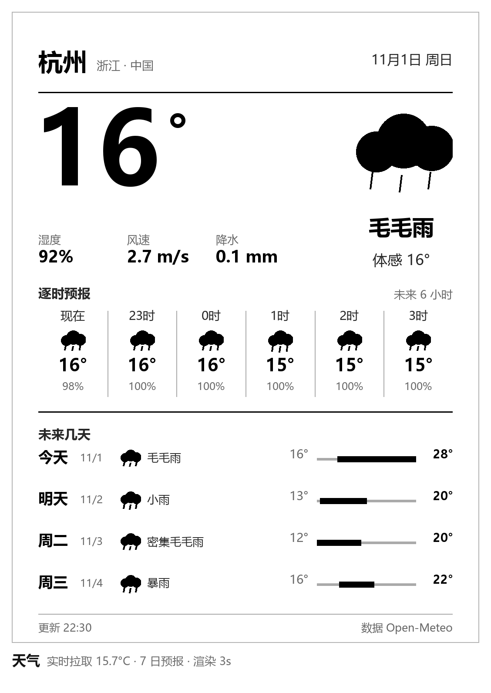
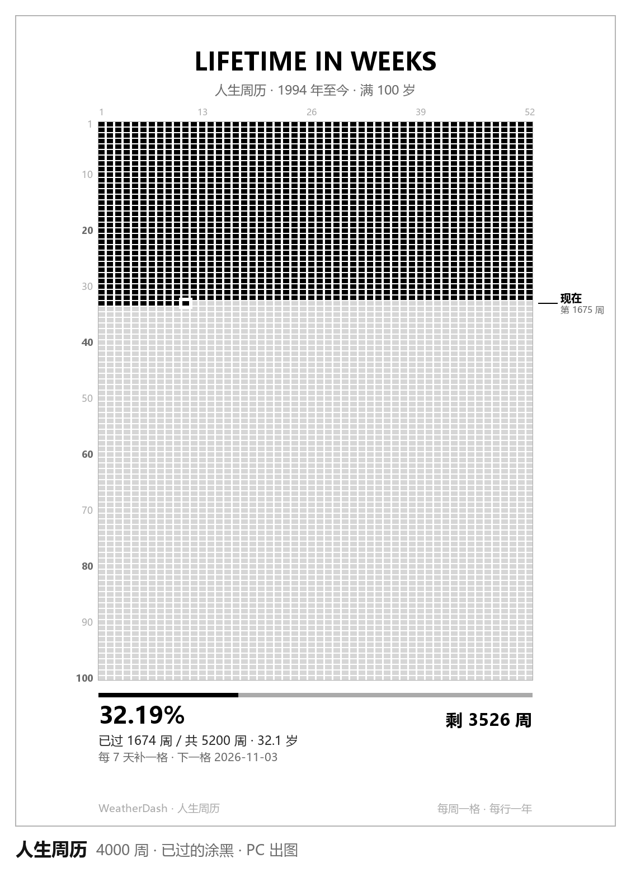
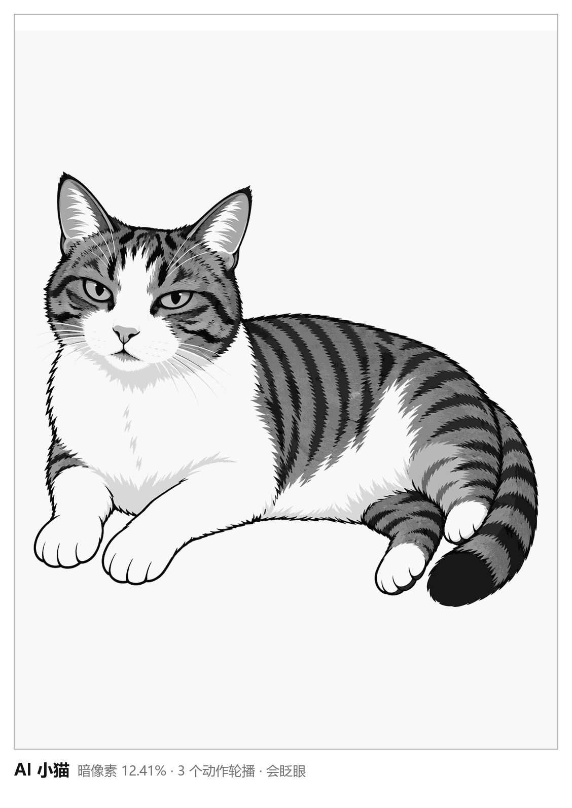

# kindle-dashboard

把一台闲置的 Kindle Paperwhite 3（越狱后）变成挂在墙上的信息屏：日历、天气、人生周历，以及一只真的会动的猫。

触摸翻页，长按退出，全部局域网离线运行，一周充一次电。


## 它长什么样

| 日历 | 天气 |
|---|---|
|  |  |

| 人生周历 | 猫 |
|---|---|
|  |  |

## 猫的 5 个动作

全部是**程序化绘制**的序列帧（不是 AI 生成），共 45 帧。之所以不用 AI，是因为 AI 生图无法保证跨帧像素一致——它每次都在重画而不是在改，拼成动画就成了抖动。

| 动作 | 帧数 | 一循环 | 帧间隔 | 波形 |
|---|---|---|---|---|
| 眨眼 | 9 | 1.4s | 150ms | A2（不闪屏） |
| 摇尾 | 8 | 2.1s | 260ms | A2 |
| 抖耳 | 6 | 1.1s | 190ms | A2 |
| 打哈欠 | 14 | 5.9s | 420ms | GC16（保灰阶） |
| 呼吸 | 8 | 9.6s | 1200ms | GC16（保灰阶） |

每个动作演 110 秒后自动换下一个。

## 架构

```
┌─────────────┐   HTTP (局域网)   ┌──────────────────┐
│  PC         │ ───────────────> │  Kindle PW3      │
│  bridge.py  │  PNG 图 / 命令    │  carousel.sh     │
│  :8899      │ <─────────────── │  agentd7.sh      │
└─────────────┘   心跳 / 结果      └──────────────────┘
```

- **PC 侧**（`pc/`）：渲染日历/天气/周历三张 PNG，提供命令队列、心跳、文件上传
- **设备侧**（`kindle/`）：轮播守护进程，按页拉图、贴屏、处理触摸、播放猫动画

设备本身算力很弱（无 Python、无编译器、Lua 无 ffi），所以复杂渲染全放 PC，设备只负责"拿图 + 贴屏 + 读触摸"。

## 关键实现说明

### 电子墨水的刷新代价

实测 PW3 的刷新耗时：

| 范围 | 波形 | 耗时 |
|---|---|---|
| 小补丁 293×129 | GC16 | 20~30ms |
| 小补丁 293×129 | A2 | 20~40ms |
| 全屏 1072×1416 | GC16 | 150ms |

小补丁只要 20~40ms，而动画帧间隔是几百毫秒——**刷新速度从来不是瓶颈**。

真正的代价是波形选择：
- **A2**：快、不闪屏，但只做黑白阈值化，中间灰会被压成同一色（实测灰阶丰富度 5.1% → 1.9%）。只适合眼睛这类黑白分明的区域。
- **GC16**：保留 16 级灰阶，但每帧先闪黑白再成像。连续用于眨眼会像"屏幕在闪"。

所以每个动作按自己的脏矩形面积选择波形：> 180000 px 用 GC16，否则用 A2。

### 状态以文件为唯一事实来源

`CAT_CUR` 这类 shell 变量每个进程一份。菜单或 `carousel.sh catnext` 在独立进程里换了动作、贴了新基图，守护进程内存里还是旧值，就会拿旧补丁往新基图上贴——表现为"新姿势里嵌一只旧眼睛"。

修法：动作状态以 `cat.pose` 文件为唯一事实来源，贴补丁前先核对。

同类问题还有 `page.idx`、`guard` 采样、`preventScreenSaver`，都在代码注释里标注了。

### 验证必须采 framebuffer

`cat.blink` 这类计数器在计算层无条件 +1，跟有没有真的贴上屏幕毫无关系。

可靠的验证只有一条：

```sh
dd if=/dev/fb0 bs=1088 skip=<y> count=<h> | md5sum
```

只采该动作的矩形，看 md5 是否在多个值间交替；同时采一个远离所有矩形的对照区，确认它**不动**——否则分不清"猫在动"还是"整屏在抖"。

本项目的实测结果：

| 动作 | 屏幕与对应帧的差异 | 帧间最大差异 |
|---|---|---|
| 眨眼 | 0 px | 7,422 |
| 抖耳 | 0 px | 12,950 |
| 打哈欠 | 0 px | 56,563 |
| 呼吸 | 86 px | 14,468 |
| 摇尾 | 907 px | 15,520 |

## 安装

### 前提

- Kindle Paperwhite 3，已越狱（本项目在 5.16.2.1.1 / LanguageBreak 上验证）
- 需要 `fbink`（`/mnt/us/libkh/bin/fbink`，随 KUAL 生态安装）
- PC 与 Kindle 在同一局域网
- PC 有 Python 3 + Pillow

### 步骤

1. **PC 侧**

```bash
cp pc/config.example.json pc/config.json   # 改城市、经纬度、生日
pip install pillow requests
python pc/bridge.py                        # 监听 :8899
```

2. **设备侧**

```bash
# 把 kindle/ 下的脚本推到 /mnt/us/weatherdash/
# 注意：必须 LF 换行，部署后比对字节数
sh /mnt/us/weatherdash/deploy.sh
```

3. **KUAL 菜单**

把 `kindle/menu.json` 放到 `/mnt/us/extensions/weatherdash/`，即可在 KUAL 里看到入口。

### 配置项

`pc/config.json`：

| 字段 | 说明 |
|---|---|
| `city` / `latitude` / `longitude` | 天气位置（open-meteo，无需 API key） |
| `life.birth` | 人生周历起点 |
| `life.years` | 总年数 |
| `page_seconds` | 每页停留秒数 |

设备侧网络地址在 `kindle/carousel.sh` 顶部：

```sh
PCIP=${PCIP:-192.168.1.100}   # 改成你 PC 的局域网 IP
```

## WiFi 自救

Kindle 的 WiFi 在路由器重启或换信道后经常连不上，且报错完全不指向真实原因。附两个 KUAL 工具：

- `wifi_repair.sh` — 自动扫描 → 关联 → 拿 IP，约 20 秒
- `wifi_diag.sh` — 打印扫描结果、关联状态、密码验证阶段

最常见的假象：

```
CTRL-EVENT-ASSOC-REJECT status_code=1
Added BSSID 00:00:00:00:00:00 into blacklist
```

看着像"路由器拒绝"，其实通常是 `ap_scan=2` 导致不扫描、BSSID 退化成全零。判断依据：**关联阶段就被拒 = 密码根本没参与验证**；密码错误的表现是关联成功后 `4-Way Handshake failed`。

改成 `ap_scan=1` 并在关联前先 `wpa_cli scan` 等目标 SSID 出现即可。

## 已知限制

- 只在 PW3 / 5.16.2.1.1 验证过，其他型号需自行调整屏幕尺寸与 `SHIFT_Y`
- 设备屏幕 1072×1448，但 framebuffer 行宽是 1088，贴图 y 需加偏移 32（顶部状态栏）
- 顶部 0..31 行不得有内容，否则会被状态栏覆盖
- 呼吸动作的脏矩形仍占屏 27%（490×848），会走 GC16 全刷

## 许可

MIT
